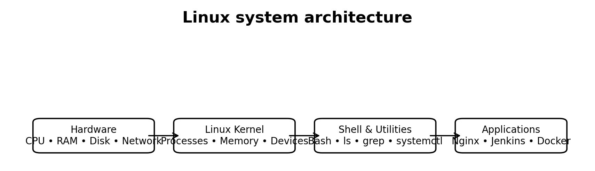

## 1. Linux fundamentals

Linux is an open-source, Unix-like operating system built around the Linux kernel. It is commonly used on cloud virtual machines, servers, containers and DevOps infrastructure.

### What is the difference between Unix and Linux?

Unix is an operating system originally developed at AT&T Bell Labs in the 1970s. Linux is an open-source, Unix-like operating system kernel created by Linus Torvalds in 1991. Unix systems are often commercially maintained by vendors, whereas Linux is open source and available through distributions such as Ubuntu, Red Hat, and Debian. Both share similar concepts, commands, and multiuser and multitasking capabilities.

**Why Linux matters in DevOps**
- Most cloud workloads and many production servers run Linux.
- Docker containers commonly use Linux-based images.
- Jenkins, Kubernetes tools, web servers and monitoring agents often run on Linux.
- Deployments, automation, log analysis and incident troubleshooting frequently require Linux commands.

**Q1. What is the kernel in Linux?**

The kernel is the core of Linux. It manages CPU, memory, processes, devices, filesystems and networking.

**Q2. What is the difference between a kernel and a shell?**

The kernel manages hardware and system resources. The shell accepts and interprets user commands.

**Q3. What is Bash?**

Bash is a command-line shell that interprets commands and executes programs.

**Q4. What is a system call?**

A system call is a mechanism through which a user-space program requests a service from the kernel.

**Q5. What happens when you execute the ls command?**

The shell executes the ls program. It requests directory information through system calls, and the output is displayed in the terminal.

| Layer | Responsibility |
|---|---|
| Hardware | CPU, RAM, disks and network devices |
| Kernel | Process scheduling, memory, device and filesystem management |
| Shell | Accepts commands and starts programs |
| Utilities | Commands such as `ls`, `grep`, `sed`, `systemctl` |
| Applications | Nginx, Jenkins, Docker and business applications |

**Kernel vs operating system:** The kernel is the core that manages hardware and system resources. A Linux distribution packages the kernel with utilities, libraries, package management and applications to form a usable operating system.

**Real-world DevOps example**

`sudo systemctl restart nginx`

**What happens?**

1. You enter the command in the terminal.
2. Bash interprets the command.
3. sudo requests elevated privileges.
4. systemctl communicates with the system service manager (systemd).
5. The service manager requests the necessary operations from the kernel.
6. The kernel manages the processes and resources involved in restarting Nginx.
7. Nginx starts running again.