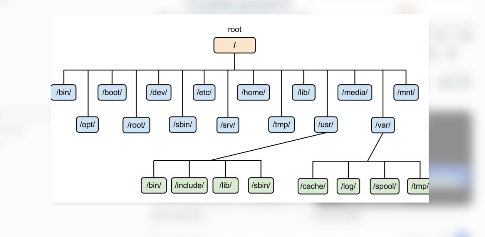

## 2. Linux filesystem hierarchy

Linux uses one directory tree beginning at `/`, called the root directory.

| Directory | Purpose |
|---|---|
| `/` | Root of the filesystem |
| `/home` | Home directories for normal users |
| `/root` | Root user's home directory |
| `/etc` | System and application configuration |
| `/var` | Variable data such as logs, cache and spool files |
| `/var/log` | System and application logs |
| `/tmp` | Temporary files |
| `/opt` | Optional or third-party application software |
| `/usr` | User-space applications, libraries and utilities |
| `/bin` | Essential user commands; often merged into `/usr/bin` on modern distributions |
| `/sbin` | System administration commands; often merged into `/usr/sbin` |
| `/proc` | Virtual filesystem exposing process and kernel information |
| `/dev` | Device files |
| `/boot` | Bootloader and kernel-related files |
| `/mnt` | Common temporary mount point |
| `/media` | Common mount point for removable media |

Useful path symbols:
- `/` = filesystem root.
- `.` = current directory.
- `..` = parent directory.
- `~` = current user's home directory.