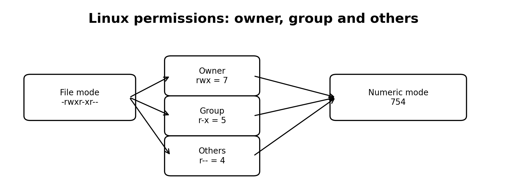

## 7. Linux file permissions

Linux permissions control who can read, write or execute a file or directory.



Three permission classes:
- `u` = owner/user.
- `g` = group.
- `o` = others.

Permission values:

| Permission | Symbol | Numeric value |
|---|---|---:|
| Read | `r` | 4 |
| Write | `w` | 2 |
| Execute | `x` | 1 |

Examples:
- `rwx` = 4 + 2 + 1 = 7.
- `rw-` = 4 + 2 = 6.
- `r-x` = 4 + 1 = 5.
- `r--` = 4.

Common modes:

| Mode | Meaning | Common use |
|---|---|---|
| `755` | Owner full; group/others read and execute | Directories and executable scripts |
| `644` | Owner read/write; group/others read | Regular files |
| `700` | Owner only | Private directory or script |
| `600` | Owner read/write only | Private key or sensitive file |

Commands:

```bash
chmod 755 deploy.sh
chmod 644 config.txt
chmod 700 private-directory
chmod +x deploy.sh
chmod u+x deploy.sh
sudo chown ubuntu:ubuntu app.log
sudo chown -R ubuntu:ubuntu /var/www/html
```

- `chmod` changes permissions.
- `chown` changes owner and group.
- `-R` applies recursively.

**Why avoid `chmod 777`?** It grants read, write and execute permissions to everyone. This can expose files to unauthorized modification or execution. Apply least privilege instead.

**Directory permission detail:** On a directory, `r` allows listing names, `w` allows creating/deleting entries (usually together with `x`), and `x` allows traversing/accessing entries when their permissions allow it.