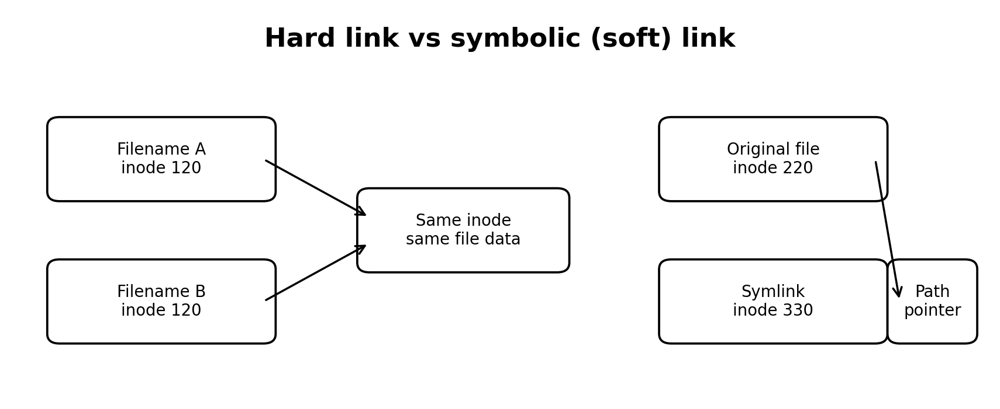

## 8. Hard links and soft links (symbolic links)

A link is another directory entry or path that refers to a file.



### 8.1 Hard link

A hard link is an additional filename that points to the **same inode** as the original file. It refers to the same underlying file data.

Create one:

```bash
echo "DevOps notes" > original.txt
ln original.txt hardlink.txt
```

Inspect inode numbers:

```bash
ls -li original.txt hardlink.txt
```

Both names should show the same inode number.

**Characteristics**
- Both names refer to the same inode and data.
- Removing one filename does not remove the data while another hard link remains.
- Changes made through either name affect the same file content.
- Normally cannot be created for directories by regular users.
- Cannot normally cross filesystem boundaries.

### 8.2 Soft link / symbolic link

A symbolic link is a separate file containing a path to another file or directory.

Create one:

```bash
ln -s original.txt softlink.txt
```

Inspect:

```bash
ls -l original.txt softlink.txt
ls -li original.txt softlink.txt
```

The symbolic link has its own inode and points to the target path.

**Characteristics**
- Can point to files or directories.
- Can cross filesystem boundaries.
- Can point to a target that does not currently exist (a dangling link).
- If the target is deleted or moved, the link may become broken.
- Removing the symlink does not delete the target.

### 8.3 Hard link vs soft link

| Feature | Hard link | Soft link |
|---|---|---|
| Points to | Same inode | Target path |
| Inode | Same as original | Has its own inode |
| Cross filesystem | No | Yes |
| Link to directory | Generally not allowed for users | Yes |
| Target deleted | Data remains while another hard link exists | Link becomes dangling if target path disappears |
| Link command | `ln source link` | `ln -s target link` |

### 8.4 Hands-on test

```bash
mkdir link-lab
cd link-lab

echo "hello Linux" > original.txt
ln original.txt hard.txt
ln -s original.txt soft.txt

ls -li
cat hard.txt
cat soft.txt

rm original.txt
cat hard.txt
cat soft.txt
```

Expected:
- `hard.txt` still works because it refers to the same inode and data.
- `soft.txt` becomes broken because its target path no longer exists.

To inspect link counts:

```bash
stat hard.txt
```

Look for the link count in the output.