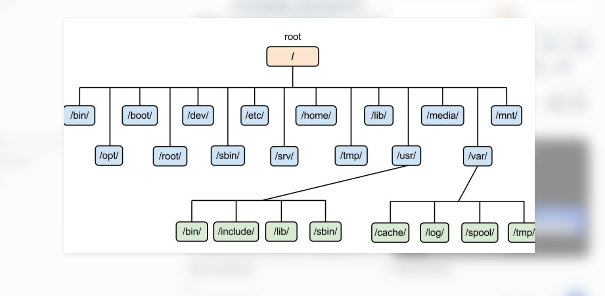
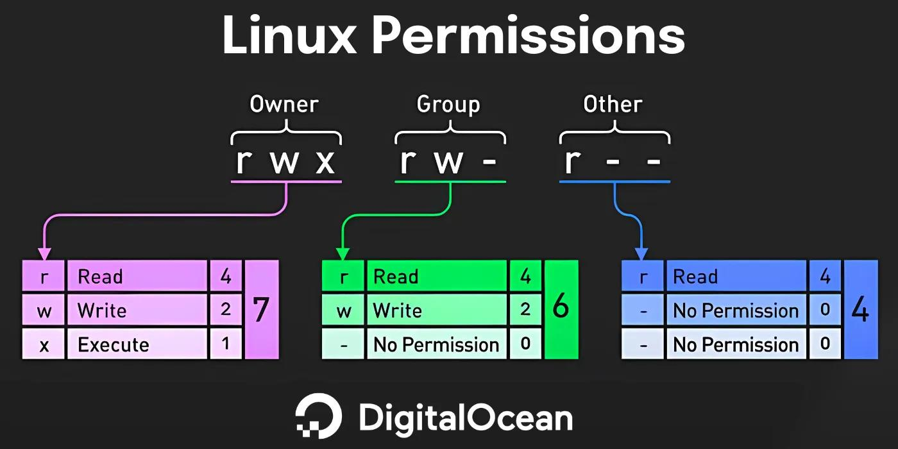
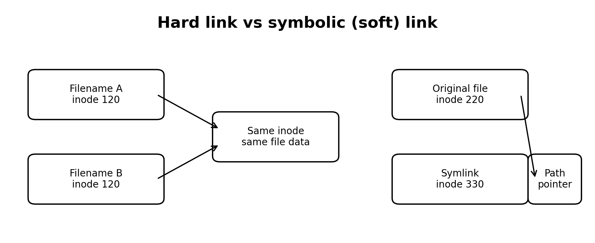

# Linux for DevOps – Revision Notes

**Day 1 | Interview preparation | Concepts + commands + hands-on + scenarios**

> Goal: Be able to operate a Linux server, inspect logs, manage users and permissions, troubleshoot processes and services, and automate routine tasks.

## Contents

1. [Linux fundamentals and architecture](/1-linux-fundamentals-and-architecture.mdx)
2. Filesystem hierarchy
3. Navigation and file commands
4. Searching, pipes and text processing
5. `sed` command
6. Users and groups
7. File permissions
8. Hard links and soft links
9. Processes and signals
10. Services and systemd
11. Logs and troubleshooting
12. Disk, memory and CPU
13. Networking commands and ports
14. Package management
15. SSH
16. Shell scripting
17. DevOps troubleshooting scenarios
18. Hands-on lab
19. Interview questions and quick revision sheet

## 2. Linux filesystem hierarchy

Linux uses one directory tree beginning at `/`, called the root directory.



| Directory | Purpose |
|---|---|
| `/` | Root of the filesystem |
| `/home` | Home directories for normal users |
| `/root` | Root user's home directory |
| `/etc` | System and application configuration |
| `/var` | Variable data such as logs, cache and spool files |
| `/var/log` | System and application logs |
| `/tmp` | Temporary files |
| `/opt` | Optional or third-party application software |
| `/usr` | User-space applications, libraries and utilities |
| `/bin` | Essential user commands; often merged into `/usr/bin` on modern distributions |
| `/sbin` | System administration commands; often merged into `/usr/sbin` |
| `/proc` | Virtual filesystem exposing process and kernel information |
| `/dev` | Device files |
| `/boot` | Bootloader and kernel-related files |
| `/mnt` | Common temporary mount point |
| `/media` | Common mount point for removable media |

Useful path symbols:
- `/` = filesystem root.
- `.` = current directory.
- `..` = parent directory.
- `~` = current user's home directory.

## 3. Navigation and file management

| Command | What it does | Example |
|---|---|---|
| `pwd` | Print current directory | `pwd` |
| `ls` | List directory contents | `ls` |
| `ls -l` | Long listing | `ls -l` |
| `ls -la` | Include hidden files | `ls -la` |
| `cd` | Change directory | `cd /var/log` |
| `cd ..` | Move to parent | `cd ..` |
| `cd ~` | Go to home | `cd ~` |
| `touch` | Create empty file/update timestamp | `touch app.log` |
| `mkdir` | Create directory | `mkdir app` |
| `mkdir -p` | Create nested directories | `mkdir -p app/logs/archive` |
| `cp` | Copy file | `cp a.txt b.txt` |
| `cp -r` | Copy directory recursively | `cp -r app app-backup` |
| `mv` | Move or rename | `mv old.txt new.txt` |
| `rm` | Remove file | `rm app.log` |
| `rm -r` | Remove directory recursively | `rm -r old-app` |
| `cat` | Print file contents | `cat app.log` |
| `less` | Read file page by page | `less app.log` |
| `head` | First lines | `head -n 10 app.log` |
| `tail` | Last lines | `tail -n 20 app.log` |
| `tail -f` | Follow a growing log | `tail -f app.log` |

**Caution:** `rm -rf` recursively and forcefully deletes paths. Double-check the path before running it, especially with `sudo` or on production machines.

## 4. Searching, pipes and text processing

### `find` – search for files

```bash
find /var/log -name "*.log"
find . -type f -name "*.conf"
find /var/log -type f -size +100M
```

Common options:
- `-name` matches a filename.
- `-type f` searches regular files.
- `-type d` searches directories.
- `-size +100M` finds files larger than 100 MB.

### `grep` – search inside text

```bash
grep "ERROR" app.log
grep -i "error" app.log
grep -n "ERROR" app.log
grep -r "database" /etc/
grep -c "ERROR" app.log
```

| Option | Meaning |
|---|---|
| `-i` | Ignore case |
| `-n` | Show line numbers |
| `-r` | Search recursively |
| `-v` | Show lines that do not match |
| `-c` | Count matching lines |
| `-E` | Use extended regular expressions |

### Pipes and redirection

A pipe (`|`) passes the output of one command as input to another.

```bash
grep "ERROR" app.log | wc -l
```

Redirection:
```bash
echo "deployment started" > deploy.log
echo "deployment completed" >> deploy.log
command > output.txt 2> errors.txt
command >> combined.log 2>&1
```

- `>` overwrites a file.
- `>>` appends to a file.
- `2>` redirects standard error.
- `2>&1` sends standard error to the same destination as standard output.

### Other useful text commands

```bash
wc -l app.log
sort names.txt
sort names.txt | uniq
cut -d: -f1 /etc/passwd
awk '{print $1}' access.log
```

## 5. `sed` – stream editor

`sed` is a command-line stream editor used to search, replace, delete, print and transform text. It is useful in configuration editing, log processing and shell scripts.

### 5.1 Search and replace

```bash
sed 's/old/new/' file.txt
```

Replaces the first occurrence on each line in the output.

```bash
sed 's/old/new/g' file.txt
```

Replaces every occurrence on each line in the output.

### 5.2 Edit a file in place

```bash
sed -i 's/localhost/127.0.0.1/g' config.txt
```

`-i` modifies the file itself. On important files, make a backup first:

```bash
sed -i.bak 's/localhost/127.0.0.1/g' config.txt
```

This creates `config.txt.bak` before editing.

### 5.3 Delete lines

```bash
sed '3d' file.txt
```

Prints the file with line 3 removed.

```bash
sed '1,5d' file.txt
```

Prints the file with lines 1 through 5 removed.

```bash
sed '/DEBUG/d' app.log
```

Prints the file without lines containing `DEBUG`.

### 5.4 Print selected lines

```bash
sed -n '5p' file.txt
sed -n '10,20p' file.txt
sed -n '/ERROR/p' app.log
```

`-n` suppresses default printing; `p` prints only selected lines.

### 5.5 Replace only on a matching line

```bash
sed '/database/s/localhost/db.internal/' config.txt
```

Only lines containing `database` are modified in the output.

### 5.6 Practical DevOps examples

Replace an image tag in a deployment manifest:

```bash
sed -i 's|image: myapp:old|image: myapp:v2|' deployment.yaml
```

Extract error lines:

```bash
sed -n '/ERROR/p' application.log
```

Remove blank lines from output:

```bash
sed '/^[[:space:]]*$/d' config.txt
```

**`sed` vs `grep` vs `awk`:**

| Tool | Main purpose |
|---|---|
| `grep` | Find matching lines |
| `sed` | Transform or edit streams of text |
| `awk` | Process structured text by fields and patterns |

## 6. Users and groups

Linux is a multi-user operating system. Each user has a UID (user ID) and belongs to one or more groups.

```bash
whoami
id
who
```

| Command | Purpose |
|---|---|
| `whoami` | Current username |
| `id` | UID, primary group and supplementary groups |
| `who` | Logged-in sessions |
| `sudo useradd -m devopsuser` | Create a user with a home directory |
| `sudo passwd devopsuser` | Set user's password |
| `sudo groupadd developers` | Create a group |
| `sudo usermod -aG developers devopsuser` | Add user to supplementary group |
| `su - devopsuser` | Switch user with login environment |
| `sudo command` | Run command with elevated privileges |

**Important:** `-aG` appends a supplementary group. Using `-G` without `-a` can replace the user's supplementary group list.

Root has UID `0` and administrative privileges. Use a normal account for routine work and `sudo` only when required.

## 7. Linux file permissions

Linux permissions control who can read, write or execute a file or directory.



Three permission classes:
- `u` = owner/user.
- `g` = group.
- `o` = others.

Permission values:

| Permission | Symbol | Numeric value |
|---|---|---:|
| Read | `r` | 4 |
| Write | `w` | 2 |
| Execute | `x` | 1 |

Examples:
- `rwx` = 4 + 2 + 1 = 7.
- `rw-` = 4 + 2 = 6.
- `r-x` = 4 + 1 = 5.
- `r--` = 4.

Common modes:

| Mode | Meaning | Common use |
|---|---|---|
| `755` | Owner full; group/others read and execute | Directories and executable scripts |
| `644` | Owner read/write; group/others read | Regular files |
| `700` | Owner only | Private directory or script |
| `600` | Owner read/write only | Private key or sensitive file |

Commands:

```bash
chmod 755 deploy.sh
chmod 644 config.txt
chmod 700 private-directory
chmod +x deploy.sh
chmod u+x deploy.sh
sudo chown ubuntu:ubuntu app.log
sudo chown -R ubuntu:ubuntu /var/www/html
```

- `chmod` changes permissions.
- `chown` changes owner and group.
- `-R` applies recursively.

**Why avoid `chmod 777`?** It grants read, write and execute permissions to everyone. This can expose files to unauthorized modification or execution. Apply least privilege instead.

**Directory permission detail:** On a directory, `r` allows listing names, `w` allows creating/deleting entries (usually together with `x`), and `x` allows traversing/accessing entries when their permissions allow it.

## 8. Hard links and soft links (symbolic links)

A link is another directory entry or path that refers to a file.



### 8.1 Hard link

A hard link is an additional filename that points to the **same inode** as the original file. It refers to the same underlying file data.

Create one:

```bash
echo "DevOps notes" > original.txt
ln original.txt hardlink.txt
```

Inspect inode numbers:

```bash
ls -li original.txt hardlink.txt
```

Both names should show the same inode number.

**Characteristics**
- Both names refer to the same inode and data.
- Removing one filename does not remove the data while another hard link remains.
- Changes made through either name affect the same file content.
- Normally cannot be created for directories by regular users.
- Cannot normally cross filesystem boundaries.

### 8.2 Soft link / symbolic link

A symbolic link is a separate file containing a path to another file or directory.

Create one:

```bash
ln -s original.txt softlink.txt
```

Inspect:

```bash
ls -l original.txt softlink.txt
ls -li original.txt softlink.txt
```

The symbolic link has its own inode and points to the target path.

**Characteristics**
- Can point to files or directories.
- Can cross filesystem boundaries.
- Can point to a target that does not currently exist (a dangling link).
- If the target is deleted or moved, the link may become broken.
- Removing the symlink does not delete the target.

### 8.3 Hard link vs soft link

| Feature | Hard link | Soft link |
|---|---|---|
| Points to | Same inode | Target path |
| Inode | Same as original | Has its own inode |
| Cross filesystem | No | Yes |
| Link to directory | Generally not allowed for users | Yes |
| Target deleted | Data remains while another hard link exists | Link becomes dangling if target path disappears |
| Link command | `ln source link` | `ln -s target link` |

### 8.4 Hands-on test

```bash
mkdir link-lab
cd link-lab

echo "hello Linux" > original.txt
ln original.txt hard.txt
ln -s original.txt soft.txt

ls -li
cat hard.txt
cat soft.txt

rm original.txt
cat hard.txt
cat soft.txt
```

Expected:
- `hard.txt` still works because it refers to the same inode and data.
- `soft.txt` becomes broken because its target path no longer exists.

To inspect link counts:

```bash
stat hard.txt
```

Look for the link count in the output.

## 9. Processes and signals

A process is a running instance of a program. Each process has a PID (process ID).

```bash
ps aux
ps -ef
top
pgrep nginx
free -h
```

Sort processes by CPU or memory:

```bash
ps aux --sort=-%cpu | head
ps aux --sort=-%mem | head
```

Terminate a process:

```bash
kill 1234
kill -9 1234
```

- `kill PID` sends SIGTERM (15) by default. It requests graceful termination.
- `kill -9 PID` sends SIGKILL (9). It forces termination and cannot be caught or handled by the process.

Background jobs:

```bash
sleep 300 &
jobs
```

Use `fg` and `bg` to move jobs between foreground and background in the current shell.

## 10. Services and systemd

Many Linux distributions use `systemd` to manage background services.

```bash
sudo systemctl status nginx
sudo systemctl start nginx
sudo systemctl stop nginx
sudo systemctl restart nginx
sudo systemctl reload nginx
sudo systemctl enable nginx
sudo systemctl disable nginx
systemctl is-active nginx
systemctl is-enabled nginx
```

| Action | Meaning |
|---|---|
| `start` | Start service now |
| `stop` | Stop service now |
| `restart` | Stop and start service |
| `reload` | Ask service to reload configuration, if supported |
| `enable` | Configure service to start at boot |
| `disable` | Prevent automatic startup at boot |

**Restart vs reload:** Restart performs a service restart and may interrupt active work. Reload asks the service to re-read configuration, usually without a full restart, if the service supports it.

## 11. Logs and troubleshooting

Logs provide evidence about application, service and operating-system behavior.

Common locations (distribution and configuration dependent):

| Log | Purpose |
|---|---|
| `/var/log/syslog` | General system messages on some Debian/Ubuntu systems |
| `/var/log/auth.log` | Authentication messages on Debian/Ubuntu |
| `/var/log/kern.log` | Kernel messages on some Debian/Ubuntu systems |
| `/var/log/messages` | General messages on some RHEL-family systems |
| `/var/log/nginx/access.log` | Nginx access log |
| `/var/log/nginx/error.log` | Nginx error log |

`journalctl` reads the systemd journal:

```bash
journalctl
journalctl -u nginx
journalctl -u nginx -n 100
journalctl -u nginx -f
journalctl -p err
journalctl --since "1 hour ago"
```

Useful log commands:

```bash
tail -f /var/log/nginx/error.log
grep -i "error" /var/log/nginx/error.log
grep -c "ERROR" application.log
```

## 12. Disk, memory, CPU and uptime

```bash
df -h
du -sh /var/log
du -sh /var/*
lsblk
free -h
top
uptime
```

| Command | Purpose |
|---|---|
| `df -h` | Filesystem capacity and usage |
| `du -sh path` | Size of a directory or file |
| `lsblk` | Block devices and partitions |
| `free -h` | Memory and swap usage |
| `top` | Live process and resource view |
| `uptime` | Uptime and load averages |

**Disk full troubleshooting:**
1. `df -h` identifies which filesystem is full.
2. `du -sh /var/*` helps find large directories.
3. Inspect logs, application data and temporary files.
4. Clean only files confirmed safe to remove.
5. Configure log rotation or expand storage if needed.

A deleted file may still consume disk space if a running process keeps it open. Tools such as `lsof +L1` can help find deleted-but-open files if `lsof` is installed.

## 13. Networking commands

| Command | Purpose |
|---|---|
| `ip addr` | Show interfaces and IP addresses |
| `ip route` | Show routing table |
| `ping host` | Test reachability |
| `curl -I URL` | Fetch HTTP response headers |
| `curl -v URL` | Verbose connection troubleshooting |
| `ss -tulpn` | Show listening TCP/UDP sockets |
| `nslookup domain` | DNS lookup |
| `dig domain` | Detailed DNS lookup |
| `traceroute host` | Trace network path, if installed |
| `ssh user@host` | Remote SSH connection |

Common ports:

| Port | Service |
|---:|---|
| 22 | SSH |
| 53 | DNS |
| 80 | HTTP |
| 443 | HTTPS |
| 3306 | MySQL |
| 5432 | PostgreSQL |
| 8080 | Common Jenkins default |
| 6443 | Kubernetes API server |

Check if a port is listening:

```bash
sudo ss -tulpn | grep ':8080'
```

Test local application response:

```bash
curl -v http://localhost:8080
```

A port listening on the server does not automatically mean it is reachable from the internet. Check host firewall rules, cloud security groups, network ACLs and routing.

## 14. Package management

Package managers install, update and remove software.

| Debian/Ubuntu | RHEL/Amazon Linux family |
|---|---|
| `sudo apt update` | `sudo dnf check-update` |
| `sudo apt install nginx` | `sudo dnf install nginx` |
| `sudo apt remove nginx` | `sudo dnf remove nginx` |
| `sudo apt upgrade` | `sudo dnf upgrade` |
| `dpkg -l` | `rpm -qa` |

`apt update` refreshes package indexes; `apt upgrade` installs available updates.

## 15. SSH – Secure Shell

SSH provides encrypted remote access to Linux machines.

```bash
ssh ubuntu@192.168.1.10
ssh -i my-key.pem ubuntu@server-ip
```

Restrict private key permissions:

```bash
chmod 400 my-key.pem
```

SSH key authentication uses:
- **Private key:** kept secret by the client.
- **Public key:** installed on the server, commonly in `~/.ssh/authorized_keys`.

Never share or commit private keys to Git repositories.

## 16. Shell scripting basics

Shell scripts automate repetitive tasks.

Example `deploy.sh`:

```bash
#!/bin/bash
set -e

APP_NAME="demo-app"
echo "Starting deployment for $APP_NAME"

mkdir -p /tmp/deployment
date

echo "Deployment completed"
```

Run it:

```bash
chmod +x deploy.sh
./deploy.sh
```

Variables:

```bash
APP_NAME="myapp"
echo "$APP_NAME"
```

Condition:

```bash
if [ -f "/tmp/app.log" ]; then
    echo "Log file exists"
else
    echo "Log file does not exist"
fi
```

Loop:

```bash
for i in 1 2 3
do
    echo "Running task $i"
done
```

Exit code:

```bash
echo $?
```

- `0` generally means success.
- Non-zero generally means failure.

`set -e` causes a script to exit when an unhandled command fails. For production scripts, understand its behavior and handle expected failures deliberately.

## 17. DevOps troubleshooting scenarios

### Scenario 1: Server CPU usage is 100%

```bash
top
ps aux --sort=-%cpu | head
```

Identify the process, inspect its logs and determine whether the workload is expected. Do not kill processes blindly.

### Scenario 2: Disk usage is 100%

```bash
df -h
du -sh /var/*
```

Find large directories and files. Inspect logs and application data before cleaning. Consider log rotation and disk expansion.

### Scenario 3: Nginx is not starting

```bash
sudo systemctl status nginx
sudo journalctl -u nginx -n 100
sudo nginx -t
sudo ss -tulpn | grep ':80'
```

Check syntax, logs, port conflicts, permissions and configuration.

### Scenario 4: Jenkins is not accessible on port 8080

```bash
sudo systemctl status jenkins
sudo ss -tulpn | grep ':8080'
curl -v http://localhost:8080
sudo journalctl -u jenkins -n 100
```

Then verify firewall and cloud security group rules.

### Scenario 5: Application returns HTTP 502

- Check whether the application process is running.
- Check whether the application is listening on the expected port.
- Inspect Nginx or load balancer logs.
- Test the upstream locally with `curl`.
- Check network rules and application health.

### Scenario 6: User gets permission denied

```bash
ls -l file.txt
id username
namei -l /path/to/file
```

Check ownership, file permissions and execute permission on every parent directory. Fix only the required permission or ownership.

### Scenario 7: DNS is not resolving

```bash
nslookup example.com
dig example.com
cat /etc/resolv.conf
```

Check DNS configuration, resolver availability and network connectivity.

## 18. Hands-on Linux lab

Run these commands on your Linux VM, WSL or EC2 instance. Avoid running destructive commands on production.

### Task A – Create a practice structure

```bash
mkdir -p ~/devops-day1/{scripts,logs,backup}
cd ~/devops-day1
pwd
ls -la
```

### Task B – Create and inspect a log

```bash
cat > logs/app.log <<'EOF'
INFO Application started
INFO Database connected
ERROR Database connection timeout
WARNING Retry attempt 1
ERROR Request failed
INFO Application stopped
EOF

cat logs/app.log
grep -n "ERROR" logs/app.log
grep -c "ERROR" logs/app.log
tail -n 3 logs/app.log
```

### Task C – Practice `sed`

```bash
sed 's/INFO/INFORMATION/g' logs/app.log
sed -n '/ERROR/p' logs/app.log
sed '/WARNING/d' logs/app.log
```

Try a safe in-place edit on a copy:

```bash
cp logs/app.log logs/app-copy.log
sed -i.bak 's/INFO/DEBUG/g' logs/app-copy.log
```

### Task D – Practice permissions

```bash
touch scripts/deploy.sh
chmod 755 scripts/deploy.sh
ls -l scripts/deploy.sh
```

### Task E – Practice hard and soft links

```bash
echo "Linux links lab" > original.txt
ln original.txt hard.txt
ln -s original.txt soft.txt
ls -li original.txt hard.txt soft.txt
```

Observe inode numbers. Then remove `original.txt` and test which link still works:

```bash
rm original.txt
cat hard.txt
cat soft.txt
```

### Task F – Inspect resources and processes

```bash
df -h
free -h
uptime
ps aux --sort=-%mem | head
sleep 300 &
jobs
```

Find and stop the test process:

```bash
pgrep -af "sleep 300"
kill <PID>
```

Replace `<PID>` with the actual process ID returned by `pgrep`.

## 19. Interview questions – 20 questions

Study these for one hour. First try answering aloud without looking at the answer. Then compare your response.

### Fundamentals

**1. What is Linux?**

Linux is an open-source, Unix-like operating system built around the Linux kernel. It is widely used in cloud servers, containers and production infrastructure.

**2. What is the difference between kernel and shell?**

The kernel manages system resources and hardware. The shell provides a command interface through which users interact with the operating system.

**3. What is the difference between `/etc` and `/var`?**

`/etc` stores configuration files. `/var` stores variable data such as logs, cache and spool files.

**4. What is a process?**

A process is an executing instance of a program. It has a PID and consumes resources such as CPU and memory.

**5. What is the difference between root and a normal user?**

Root has UID 0 and broad administrative privileges. A normal user has restricted permissions and can use `sudo` for authorized administrative tasks.

### Commands and permissions

**6. What is the difference between `grep`, `sed` and `awk`?**

`grep` searches matching lines, `sed` transforms text streams, and `awk` processes text using patterns and fields.

**7. What is the difference between `>` and `>>`?**

`>` overwrites a file. `>>` appends to an existing file.

**8. Explain chmod 755.**

The owner has read, write and execute (7). Group and others have read and execute (5).

**9. What is the difference between chmod and chown?**

`chmod` changes permissions; `chown` changes ownership.

**10. What is the difference between hard and soft links?**

A hard link points to the same inode as the original file. A soft link is a separate file that points to a target path. A soft link can become broken if its target disappears.

### Processes, services and logs

**11. What is the difference between `kill` and `kill -9`?**

`kill` sends SIGTERM by default, requesting graceful termination. `kill -9` sends SIGKILL and forces termination.

**12. What is systemd?**

Systemd is an init and service manager used by many Linux distributions to start and manage services and system processes.

**13. What is the difference between restart and reload?**

Restart stops and starts a service. Reload asks a service to re-read its configuration without a full restart, if supported.

**14. How do you check real-time logs?**

Use `tail -f /path/to/log` for a regular log file or `journalctl -u service-name -f` for a systemd service.

**15. How do you find the largest files or directories?**

Use `du -sh` to inspect directory sizes, `find` to locate large files, and `df -h` to identify full filesystems.

### Links, networking and scripting

**16. How do you check which process is listening on port 8080?**

```bash
sudo ss -tulpn | grep ':8080'
```

**17. What is SSH and why is it secure?**

SSH provides encrypted remote access. It protects credentials and data in transit and supports public-key authentication.

**18. What is the purpose of `sed -i`?**

It edits a file in place. For example, `sed -i 's/old/new/g' file.txt` replaces matching text in the file itself.

**19. What is an exit code in Linux?**

It is the status returned by a command. `0` conventionally indicates success, while a non-zero value indicates an error or other condition.

**20. A production server is down. What is your Linux troubleshooting approach?**

Check connectivity, CPU and memory, disk space, service status, application logs, listening ports and recent changes. Identify the root cause, restore service safely and verify application health.

## 20. One-page quick revision sheet

| Topic | Remember these |
|---|---|
| Navigation | `pwd`, `ls -la`, `cd` |
| Files | `touch`, `mkdir -p`, `cp`, `mv`, `rm` |
| Reading | `cat`, `less`, `head`, `tail -f` |
| Search | `find`, `grep -i`, `grep -r` |
| Text editing | `sed`, `awk`, `cut` |
| Users | `whoami`, `id`, `useradd`, `usermod` |
| Permissions | `chmod`, `chown`, `755`, `644` |
| Links | `ln`, `ln -s`, `ls -li` |
| Processes | `ps aux`, `top`, `pgrep`, `kill` |
| Services | `systemctl`, `journalctl` |
| Disk/memory | `df -h`, `du -sh`, `free -h` |
| Networking | `ip addr`, `ss`, `curl`, `dig`, `ping` |
| Remote access | `ssh`, `chmod 400 key.pem` |
| Scripting | variables, conditions, loops, exit codes |

---

## Self-assessment checklist

Mark each topic only after you can explain it and demonstrate it without copying the notes.

- [ ] Explain Linux architecture and filesystem hierarchy.
- [ ] Navigate directories and manage files.
- [ ] Search logs using `grep`, `find`, pipes and `sed`.
- [ ] Create users and groups.
- [ ] Explain `chmod`, `chown` and numeric permissions.
- [ ] Demonstrate hard links and soft links.
- [ ] Inspect and terminate processes safely.
- [ ] Manage services using `systemctl`.
- [ ] Read logs using `journalctl` and `tail`.
- [ ] Troubleshoot disk, memory, CPU and network issues.
- [ ] Connect to a remote server using SSH.
- [ ] Write and execute a basic shell script.
- [ ] Answer all 20 interview questions aloud.

**Interview preparation tip:** Don't just memorize commands. For every command, know what problem it solves, what its output means, and what you would do next based on that output.
